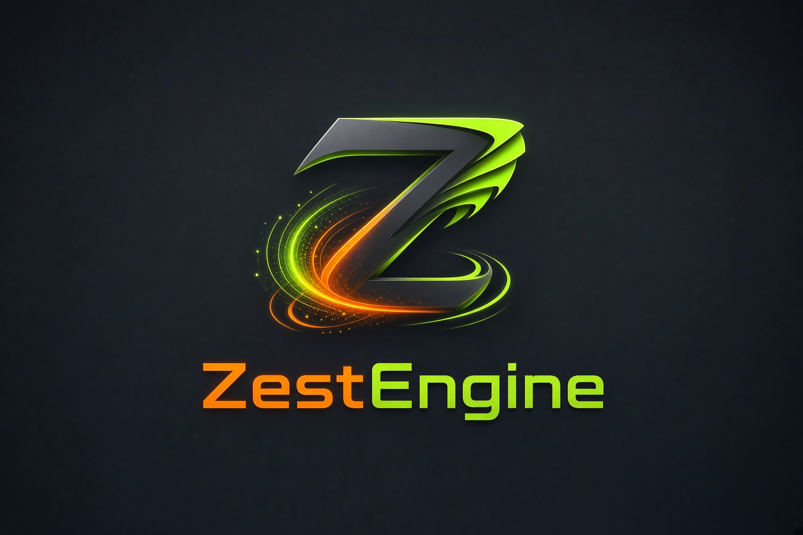

<!-- Copied from README.md in the engine repository by sync.py. Edit it there, then run ./sync.py. -->

# What is ZestEngine

ZestEngine is a standalone 3D game engine in Rust + Vulkan with a dockable in-engine
editor. It's a general-purpose desktop + VR engine: scenes, materials, FBX/glTF
import, a component + hot-reloadable Rust-plugin system, custom shaders and a
visual shader graph, realtime global illumination (**[Flux](flux.md)**), a
lighting bake, audio (Steam Audio + voice chat), physics (rapier3d), water
simulation, networking, OpenXR VR, and building standalone games straight from
the editor.



## Stack

| Concern | Choice |
|---|---|
| Graphics | Vulkan 1.3 via [ash](https://crates.io/crates/ash) (dynamic rendering, sync2) |
| Realtime GI | **Flux** — screen-space probes marching a global distance field (no bake, no RT cores) |
| Lighting bake | Vulkan ray query (VK_KHR_ray_query / acceleration_structure) |
| VR | OpenXR via the [openxr](https://crates.io/crates/openxr) crate (Monado / SteamVR runtimes) — desktop landed, Quest on-device validation pending |
| Editor GUI | [egui](https://crates.io/crates/egui) + egui_dock, rendered in-engine |
| Worlds/props | glTF 2.0, FBX (ufbx) |
| Avatars | VRM (glTF extension): humanoid rig, expressions, spring bones; Bone Cloth for hair / skirts with auto-fitted body colliders |
| Audio | [rodio](https://crates.io/crates/rodio) (.wav/.flac/.mp3), Steam Audio spatialisation, Opus voice chat |
| Shaders | zestengine standard uber-shader (Poiyomi-inspired) + runtime custom GLSL + the visual shader graph |
| Windowing | winit |

## Workspace layout

```
crates/
  zestengine          binary entry point (desktop + VR)
  zestengine-core     egui-free runtime API: ECS data/systems, ObjectId/Ref
  zestengine-engine   shared world runtime, simulation, input, audio, networking
  zestengine-render   ash Vulkan renderer (context, swapchain, frames, bake)
  zestengine-xr       OpenXR session/swapchains/input
  zestengine-assets   glTF/FBX, .material/.scene/project files, bake sidecars
  zestengine-editor   egui editor panels (inspector, files, code editor, components)
  zestengine-hub      project launcher window (recent projects, templates)
  zestengine-relay    networking relay service and wire protocol
  zestengine-server   dedicated game server and administration tools
  zestengine-plugins  native component plugin loading and reload lifecycle
  zestengine-text     CPU text shaping, layout, glyphs and atlas management
  zestengine-render-lite render-free compatibility for headless builds
plugins/
  components      example Rust component plugin (Orbit)
```

A shipped game uses `zestengine-engine` and the shared contracts in
`zestengine-core`, without depending on the editor. Plugin inspector/gizmo code
is gated behind the plugin's `editor` feature.
